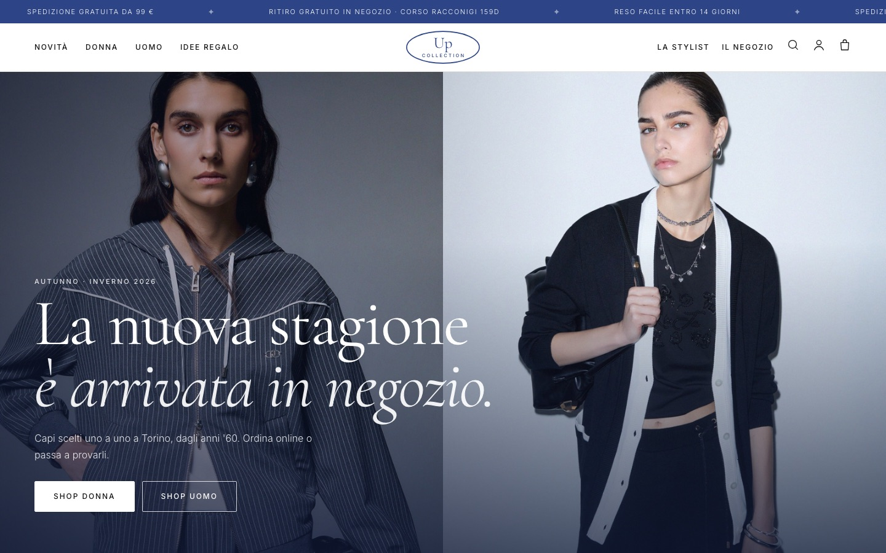
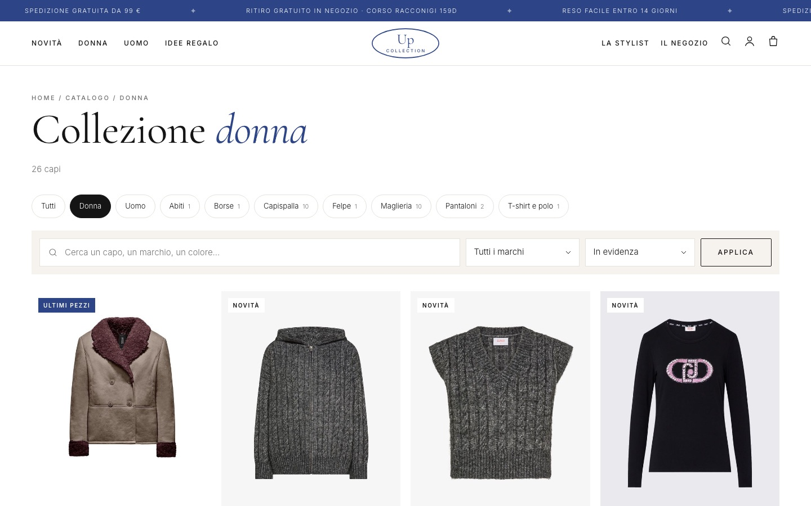
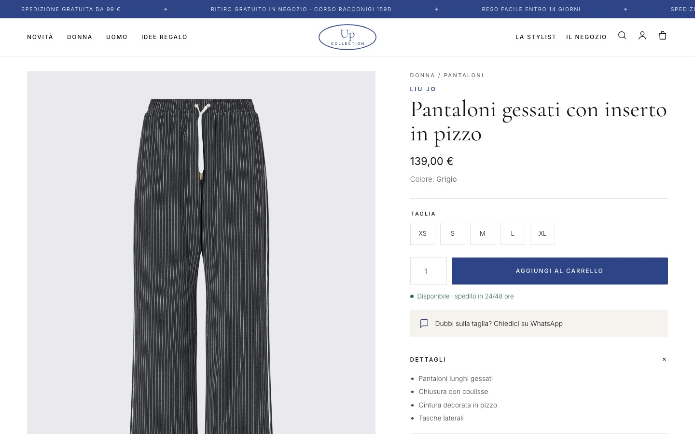

# Up Collection · e-commerce

E-commerce completo per **Up Collection**, negozio di abbigliamento uomo e donna a Torino dagli anni '60.
Scritto in **Python + Flask** con architettura **MVC**, database **SQLite** e una stylist con **IA (Groq)**.

*A full e-commerce for Up Collection, a family-run clothing store in Turin since the 1960s. Built with Python, Flask (MVC), SQLite and an AI stylist powered by Groq.*



| Catalogo | Scheda prodotto |
|---|---|
|  |  |

## Cosa fa

**Per i clienti**
- Home con novità, collezioni Donna/Uomo, marchi, storia del negozio
- Catalogo con filtri (reparto, tipo, marchio), ricerca e ordinamento per prezzo
- Scheda prodotto con galleria, scelta taglia, disponibilità e link WhatsApp
- Carrello in sessione (anche senza account), barra "spedizione gratuita da 99 €"
- Checkout con spedizione o ritiro gratuito in negozio, pagamento simulato
- Account: registrazione, login, profilo, storico ordini con stato di avanzamento
- Stylist IA: consiglia capi e abbinamenti *solo* dal catalogo reale, con le card dei prodotti sotto la risposta; aperta a tutti (5 domande gratis senza account)

**Per il negozio (admin)**
- Dashboard: incasso, ordini da preparare, clienti, scorte basse
- Prodotti: aggiungi, modifica, elimina (gli ordini passati restano nello storico)
- Ordini: filtro per stato e cambio stato (ricevuto → in preparazione → spedito/pronto → consegnato)
- Messaggi arrivati dal modulo contatti

## Struttura

```
app.py                      crea l'app, registra il blueprint e il filtro €
config.py                   chiave segreta, database, Groq, dati del negozio
models/database.py          tutte le query SQL (il controller non scrive SQL)
models/prodotti_demo.py     catalogo di esempio caricato al primo avvio
controllers/controller.py   tutte le route (Blueprint "shop") + decorator login/ruolo
templates/                  pagine Jinja (base + pagine + admin/)
static/                     CSS, font, icona
```

Scelte tecniche:
- password salvate solo come hash (`werkzeug.security`)
- query sempre parametrizzate, anche i filtri del catalogo (`? = '' OR colonna = ?`)
- l'ordine viene salvato in **una sola transazione**: se un capo non basta più, non si salva niente
- nelle righe d'ordine nome e prezzo vengono copiati, così lo storico non cambia se cambia il prodotto
- `next` dopo il login accetta solo indirizzi interni al sito

## Avvio

```bash
python3 -m venv .venv
source .venv/bin/activate
pip install -r requirements.txt
cp .env.example .env        # metti una SECRET_KEY (e, se vuoi, la GROQ_API_KEY)
flask --app app run --debug
```

Poi apri http://127.0.0.1:5000. Al primo avvio vengono creati il database e due account di prova:

| ruolo   | username  | password      |
|---------|-----------|---------------|
| admin   | `admin`   | `Admin123!`   |
| cliente | `cliente` | `Cliente123!` |

Sono account dimostrativi: prima di andare online cambiali.

## Note

- Le foto dei prodotti non sono nel repository: vengono caricate dal sito del negozio, [upcollectiontorino.com](https://upcollectiontorino.com).
- I pagamenti sono simulati: nessun addebito reale.
- La stylist funziona anche senza chiave: capisce per chi è, che capo, marca e budget e cerca nel catalogo. Con `GROQ_API_KEY` risponde il modello `openai/gpt-oss-120b` (si cambia con `GROQ_MODEL`).

---

© Up Collection. Codice, testi e marchio: tutti i diritti riservati.
Font Cormorant Garamond e Inter con licenza SIL Open Font License.
